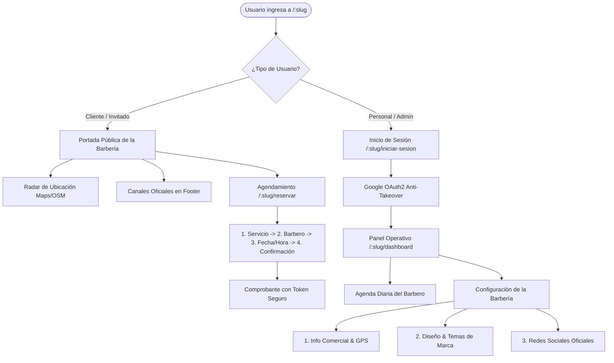

# Barbería VIP SaaS — Frontend Web App (Portal & Dashboard Multitenant)

> **Especificación de Arquitectura de Software Frontend bajo estándar Arc42 e IEEE 1063**  
> **Versión:** `2.0.0` · **Estado:** `Producción / Railway` · **Pruebas:** `142 tests en 21 archivos (Vitest)`

[](https://react.dev/)
[](https://www.typescriptlang.org/)
[](https://vitejs.dev/)
[](https://tanstack.com/query)
[](https://getbootstrap.com/)
[](https://lucide.dev/)

---

## 1. Introducción y Objetivos de Experiencia de Usuario (Arc42 §1)

El frontend de **Barbería VIP SaaS** es una Single Page Application (SPA) moderna, responsiva y altamente modular diseñada para operar simultáneamente como **portal público de agendamiento para clientes finales** y como **panel de control administrativo (*Dashboard*) para dueños de sede, administradores y barberos**.

### 1.1 Metas de Experiencia de Usuario (UX Goals)
1. **Resolución Multitenant Transparente:** La aplicación deduce automáticamente la sede activa a través del subdominio (`barberia-demo-2.tudominio.com`) o la ruta base (`/:slug`), sin requerir selección manual por parte del cliente.
2. **Sistema de Theming Reactivo en Vivo:** Soporta 6 personalidades estéticas de marca configurables por barbería (`data-tenant-theme`), con soporte dual para **Modo Claro** y **Modo Oscuro** cumpliendo con los estándares de contraste accesible WCAG AA.
3. **Agendamiento sin Fricción (Mobile-First):** Flujo de reserva optimizado en 4 pasos táctiles con tiempos de carga inferiores a 2 segundos y confirmación digital sin contraseñas obligatorias.
4. **Controles de UI Nativos y Desacoplados:** Componentes interactivos como switches de visibilidad (`.redes-switch`), modales de confirmación (`ConfirmDialog`) y selectores de plataforma vectorial inmunes a colapsos de librerías externas.

---

## 2. Restricciones Técnicas de Frontend (Arc42 §2)

* **Ecosistema:** React 19 con arquitectura basada exclusivamente en Componentes Funcionales y Hooks.
* **Tipado Estricto:** TypeScript 5.9 con comprobación exhaustiva de tipos (`tsc -b`), interfaces de dominio sincronizadas con los contratos del backend y 0 `any` en capas de datos.
* **Empaquetado y Rendimiento:** Vite 8 con Rolldown/ESBuild, división de código por rutas dinámicas (*code splitting*) y reintentos automáticos de chunks desactualizados (`lazyWithRetry`).
* **Comunicación HTTP:** Cliente `Axios` singleton con interceptores de solicitud para inyectar automáticamente el encabezado `X-Negocio-Slug` derivado del contexto activo.

---

## 3. Flujos Principales de Usuario (User Journeys) (Arc42 §3)



### Detalle de Vistas y Módulos:
1. **Portada Pública (`/:slug`):** Cabecera panorámica, radar geográfico pulsante sobre mapas, tarjetas de servicios destacados y pie de página con redes sociales dinámicas.
2. **Motor de Reservas (`/:slug/reservar`):** Selección de profesional, consulta de horas libres de 60 min en tiempo real y confirmación con nombre/teléfono.
3. **Portal del Cliente VIP (`/:slug/cliente/mi-cuenta`):** Historial de turnos, estados en vivo y botón de cancelación de 1 clic mediante token criptográfico.
4. **Panel Operativo del Barbero (`/:slug/dashboard`):** Lista de turnos asignados por fecha, visualización de clientes y acciones rápidas ("Completar cita", "No asistió").
5. **Configuración de Sede SaaS (`/:slug/configuracion`):**
   * **Pestaña 1 · Información Comercial y GPS:** Asistente interactivo con `navigator.geolocation` para autocompletar coordenadas y parser de enlaces de Google Maps.
   * **Pestaña 2 · Diseño y Recursos de Marca:** Galería de 6 temas visuales con persistencia inmediata y gestor de subida de archivos SVG/PNG.
   * **Pestaña 3 · Redes Sociales Oficiales:** Selector visual (Instagram, WhatsApp, TikTok, Facebook, Otro), control de visibilidad mediante switch ON/OFF y eliminación con `ConfirmDialog`.
6. **Hub Central de Plataforma (`/plataforma` y `/explorar`):** Catálogo de todas las barberías registradas en el SaaS con métricas consolidadas.

---

## 4. Estructura Modular del Proyecto (Arc42 §5)

El código sigue una arquitectura modular orientada a dominios (*Feature-Sliced Design*):

```
src/
├── assets/               # Recursos estáticos (logos, ilustraciones)
├── auth/                 # Contexto de autenticación y sesión
├── config/               # Marca (brand.ts) y temas por negocio (tenantTheme.ts)
├── features/             # Módulos de dominio independientes
│   ├── barberos/         # Catálogo y administración de barberos por sede
│   ├── horarios/         # Horario semanal, excepciones y bloqueos
│   ├── negocio/          # Configuración de sede, perfil de marca y redes sociales
│   ├── perfil/           # Perfil del usuario
│   ├── reservas/         # Flujo de agendamiento, portal del cliente y administración
│   ├── servicios/        # Catálogo de servicios y precios
│   ├── usuarios/         # Administradores y personal
│   └── whatsapp/         # Estado y configuración de WhatsApp
├── pages/                # Vistas de primer nivel (Home, Login, Plataforma, Catálogo…)
├── shared/               # Código transversal
│   ├── components/       # Componentes compartidos (ProtectedRoute, ErrorBoundary…)
│   ├── constants/        # Constantes (roles)
│   ├── context/          # Contextos (tema)
│   ├── layout/           # Header, Sidebar, Footer, indicador de WhatsApp
│   ├── lib/              # Utilidades; `lib/http/axios.ts` es el cliente HTTP
│   ├── routes/           # Configuración de rutas protegidas
│   ├── styles/           # Tokens CSS y temas por negocio
│   └── ui/               # Componentes atómicos (Button, Modal, ConfirmDialog…)
├── test/                 # Configuración de pruebas
└── App.tsx               # Enrutador principal y proveedores globales
```

### 4.1 Aislamiento de rutas y negocio activo
La función `obtenerNegocioSlugActivo()` (`shared/lib/http/axios.ts`) determina el negocio a partir del primer segmento de la URL. Si ese segmento está en `RUTAS_RESERVADAS` (por ejemplo `login`, `dashboard`, `reservas`, `plataforma`), no se trata como slug.
* Las rutas raíz de plataforma (`/`, `/plataforma`, `/explorar`) no cargan el perfil de ninguna barbería.
* La landing de plataforma fuerza el logo oficial de Kyrios con `<BrandLogo forceKyrios />`, para no mostrar la marca de la última sede visitada.
* El interceptor de Axios usa el token de la sede de la ruta (`token_barberia_<slug>`) y envía `X-Negocio-Slug`.

---

## 5. Theming Multitenant y Sistema de Diseño (Arc42 §8)

El diseño visual es dinámico y reactivo a nivel de nodo raíz (`<html data-tenant-theme="..." data-theme="...">`):

| Identificador de Tema | Nombre de la Personalidad | Color Primario | Tipografía de Marca |
| :--- | :--- | :--- | :--- |
| `clasico-azul` | Azul Zafiro Clásico | `#0071BC` | Barlow Condensed |
| `cyber-lime` | Cyber Lime Urbano | `#22c55e` | Outfit / Sans-serif |
| `sunset-amber` | Sunset Amber Cálido | `#ff6b35` | Plus Jakarta Sans |
| `midnight-cyan` | Midnight Cyan Neón | `#00d2ff` | Orbitron / Futurista |
| `crimson-velvet` | Crimson Velvet Rubí | `#ef233c` | Playfair Display / Editorial |
| `monochrome-noir` | Monochrome Noir B&W | `#000000` / `#ffffff` | Inter / Minimalista |

### Blindaje de Contraste Dual (Modo Claro vs Modo Oscuro)
Cada tema incluye reglas dedicadas en `tenant-themes.css` que aseguran que controles como `.btn-outline-secondary`, botones de geolocalización, tablas de reservas y pestañas de administración mantengan una relación de contraste **superior a 4.5:1 (WCAG AA)** tanto en modo oscuro como en modo claro sobre fondos blancos.

---

## 6. Guía de Instalación y Puesta en Marcha (IEEE 1063)

### 6.1 Requisitos del Sistema
* **Node.js:** `>= 20.x`
* **Gestor de paquetes:** `npm` o `pnpm`

### 6.2 Pasos de Instalación

1. **Clonar el repositorio:**
   ```bash
   git clone https://github.com/dfelipe7/Barberia-Frontend.git
   cd Barberia-Frontend
   ```

2. **Instalar dependencias:**
   ```bash
   npm install
   ```

3. **Configurar variables de entorno (`.env`):**
   ```env
   # URL del Backend NestJS
   VITE_API_URL=http://localhost:3000

   # Client ID de Google Identity Services (OAuth2)
   VITE_GOOGLE_CLIENT_ID=tu-cliente-id.apps.googleusercontent.com
   ```

4. **Ejecutar en modo desarrollo:**
   ```bash
   npm run dev
   ```
   La aplicación estará disponible en `http://localhost:5173`.

5. **Compilar para producción:**
   ```bash
   npm run build
   ```
   Genera la carpeta `dist/` optimizada y lista para servir vía Nginx o Railway.

---

## 7. Decisiones de Arquitectura de Frontend (ADRs)

* **ADR-F01 · Inyección Automática de Contexto Multitenant:** En lugar de pasar manualmente el `slug` en cada llamada a la API, el interceptor de Axios extrae el `slug` de la URL actual o subdominio y añade la cabecera `X-Negocio-Slug`, manteniendo el código de componentes limpio y desacoplado.
* **ADR-F02 · Gestión de Estado del Servidor con React Query:** Se adoptó TanStack Query para el manejo de consultas y mutaciones con cacheo inteligente, eliminación de peticiones duplicadas y sincronización mediante eventos desacoplados (`window.dispatchEvent(new Event('tenant-perfil-actualizado'))`).
* **ADR-F03 · Componentes de Interacción Puros:** Se reemplazaron llamadas intrusivas del navegador (`window.confirm`) por el componente reactivo `ConfirmDialog`, y el switch de activación de redes sociales se rediseñó en CSS puro (`.redes-switch`) para eliminar dependencias frágiles de Bootstrap en producción.

---

## 8. Testing y Seguridad

| Técnica | Estado | Evidencia |
| :--- | :---: | :--- |
| **SAST** | ✅ | SonarCloud en cada push y pull request (`.github/workflows/build.yml`), con `tsc -b` estricto y ESLint. |
| **SCA** | ✅ | `npm audit --audit-level=high` en `.github/workflows/security-audit.yml` (push, PR y cada lunes). |
| **DAST** | ➖ Fuera de alcance del frontend | Se ejecutaría contra la aplicación desplegada. Pendiente en el backend. |
| **IAST** | ➖ No aplica por ahora | No hay agente en tiempo de ejecución. |

### Pruebas automatizadas
* **Herramientas:** Vitest, Testing Library y jsdom.
* **Alcance actual:** 142 tests en 21 archivos, centrados en servicios HTTP, mappers, resolución de negocio (`axios.ts`), utilidades de fechas, `TenantBrandContext`, historial de citas del cliente e indicador de WhatsApp.
* **Cobertura:** los archivos de UI (`pages`, `components`, `layout`, `ui`, `context`) se excluyen de la métrica en `vite.config.ts` y `sonar-project.properties`; la cobertura mide la lógica.

```bash
npm run test            # ejecutar pruebas
npm run test:coverage   # pruebas con informe de cobertura (lo consume SonarCloud)
npm run build           # tsc -b + build de producción
```

---

## 9. Riesgos y Deuda Técnica

El registro vivo está en [`TECH_DEBT.md`](./TECH_DEBT.md). Pendiente de esta documentación: las pruebas actuales cubren lógica y no componentes de pantalla completos.

---

## 10. Gobernanza y Human-in-the-Loop (HITL)

Este repositorio aplica las directrices de gobernanza asistida por IA documentadas en:
* [`AGENTS.md`](./AGENTS.md): Principios operativos y limitaciones del asistente de desarrollo.
* [`TECH_DEBT.md`](./TECH_DEBT.md): Registro vivo de mejoras pendientes y deuda técnica controlada.
* `.githooks/`: Hooks de pre-commit que auditan que todo commit cuente con autorización humana expresa y trailers de trazabilidad (`AI-Assisted-By`, `AI-Model`, `AI-Session`).

---
*Documento mantenido de conformidad con las directrices de Ingeniería de Software, Arc42 e IEEE 1063.*
