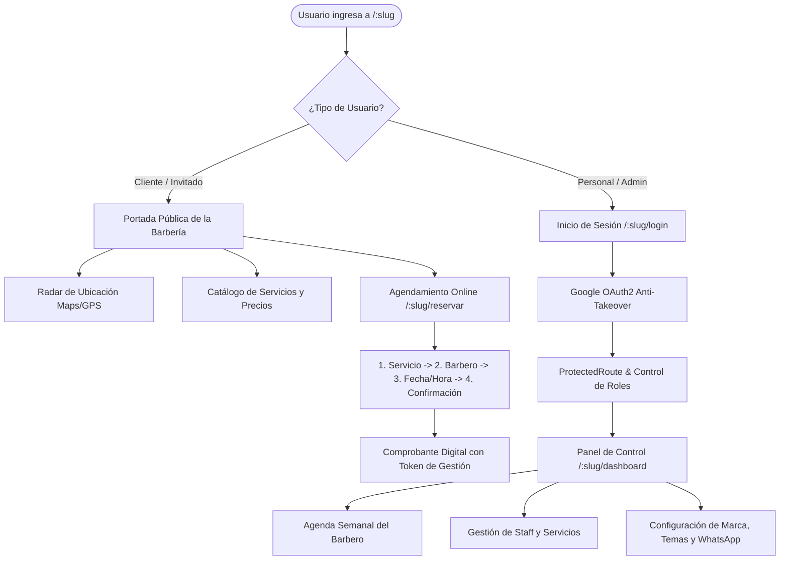

# 💈 Barbería VIP SaaS — Frontend Web App

[](https://react.dev/)
[](https://www.typescriptlang.org/)
[](https://vitejs.dev/)
[](https://tanstack.com/query)
[](https://getbootstrap.com/)
[](https://vitest.dev/)

---

## 📌 ¿Qué es este proyecto? (Contexto de la Aplicación)

El frontend de **Barbería VIP SaaS** es una Single Page Application (SPA) moderna, ultra-rápida y adaptable a dispositivos móviles. Cumple una doble función en el ecosistema:

1. **Portal Público de la Barbería (`/:slug`):**  
   Página web comercial de cada barbería con su propia identidad visual, catálogo interactivo de cortes/servicios, geolocalización por radar GPS, enlaces a redes sociales y motor de reservas online en 4 pasos táctiles sin fricción.
2. **Panel de Control Operativo y Administrativo (*Dashboard*):**  
   Plataforma de trabajo para el personal (barberos y recepcionistas) para consultar su agenda de citas en tiempo real, y para los administradores para configurar precios, personal, comisiones, plantillas de WhatsApp y el tema gráfico de su sede.

---

## 🔄 ¿Cómo funciona el Frontend? (Flujos de Usuario & Arquitectura)

La aplicación detecta de forma automática la sede activa a través del subdominio o del prefijo en la URL (`/:slug`), aislando el almacenamiento local de cada barbería:



---

## ⚡ Características Principales de la Experiencia de Usuario

* **Agendamiento Mobile-First en 4 Pasos:**  
  Flujo de reserva optimizado para pantallas táctiles con selector de profesional, cálculo de franjas horarias libres y confirmación sin necesidad de crear contraseñas.
* **Motor de Temas Reactivos en Vivo (Theming Engine):**  
  Soporta 6 personalidades de diseño (`clasico-azul`, `cyber-lime`, `sunset-amber`, `midnight-cyan`, `crimson-velvet`, `monochrome-noir`) con soporte dual de **Modo Claro** y **Modo Oscuro**, cumpliendo estándares de accesibilidad y contraste WCAG AA.
* **Aislamiento Multitenant en Navegador:**  
  Los tokens y datos de sesión se almacenan en `localStorage` con claves prefijadas (`token_barberia_${slug}`), evitando que tener dos barberías abiertas en pestañas distintas mezcle las cuentas.
* **Sincronización Inter-Pestañas:**  
  Si el usuario cierra sesión en una pestaña de una barbería, el sistema sincroniza automáticamente las demás pestañas que pertenezcan a esa misma sede sin afectar a otras.
* **Patrón Facade con React Query:**  
  La interfaz nunca hace llamadas HTTP directas ni maneja estados de carga manuales; se apoya en hooks especializados (`useBarberosCatalogo`, `useServiciosGestion`, `useMiHorario`) con invalidación inteligente de caché.

---

## 🚀 Inicio Rápido (Quick Start)

### 1. Prerrequisitos
* **Node.js** `>= 20.x`
* **Barberia-Backend** en ejecución (por defecto en `http://localhost:3000`)

### 2. Puesta en Marcha en Local

```bash
# 1. Acceder a la carpeta del frontend
cd Barberia-Frontend

# 2. Instalar dependencias
npm install

# 3. Configurar la URL de la API en las variables de entorno
# Crea un archivo .env en la raíz con la dirección del backend:
echo "VITE_API_URL=http://localhost:3000" > .env

# 4. Iniciar el servidor de desarrollo con Vite
npm run dev
```

La aplicación estará disponible en tu navegador en: [`http://localhost:5173`](http://localhost:5173).

---

## 🛠️ Comandos Disponibles

| Comando | Descripción |
| :--- | :--- |
| `npm run dev` | Inicia el servidor de desarrollo Vite con Hot Module Replacement (HMR). |
| `npm run build` | Comprueba tipos con `tsc -b` y compila para producción en `dist/`. |
| `npm run preview` | Previsualiza localmente el código compilado para producción. |
| `npm test` | Ejecuta las suites de pruebas unitarias y de componentes con Vitest. |
| `npm run lint` | Analiza el código con ESLint para asegurar buenas prácticas. |
| `npm run docs:html` | Genera localmente el portal HTML de documentación con TypeDoc en `docs/html/`. |

### 📚 Generación y Visualización de la Documentación (TypeDoc / TSDoc)

Para compilar y visualizar el portal HTML con la documentación de hooks, facades, servicios, componentes y contratos TSDoc:

```bash
# 1. Compilar el portal de documentación técnica en HTML
npm run docs:html

# 2. Abrir en el navegador el portal generado
# En Windows (PowerShell/CMD):
start docs/html/index.html

# En macOS:
open docs/html/index.html

# En Linux:
xdg-open docs/html/index.html
```

> [!NOTE]
> La carpeta generada `docs/html/` se crea de forma local y está protegida por `.gitignore` para mantener el repositorio limpio y liviano. Cualquier desarrollador puede compilarla en 2 segundos ejecutando `npm run docs:html`.

---

## 🗺️ Estructura del Código Fuente

El proyecto sigue una arquitectura orientada a características (*Feature-Sliced Design*):

```text
src/
├── auth/           # Estado global de sesión, Google OAuth2 y sincronización de pestañas
├── config/         # Configuración de marca e inyección de temas por sede
├── features/       # Módulos de dominio desacoplados
│   ├── barberos/   # Gestión de staff, comisiones porcentuales y fotos de perfil
│   ├── horarios/   # Horarios semanales, excepciones y bloqueos de agenda
│   ├── negocio/    # Identidad visual, redes sociales y geolocalización de sede
│   ├── reservas/   # Stepper de citas, portal de clientes y agenda administrativa
│   ├── servicios/  # Catálogo comercial de servicios y asignación de barberos
│   ├── usuarios/   # Administración de administradores y perfiles de usuario
│   └── whatsapp/   # Indicador de socket WhatsApp Web y renderizador de QR
├── pages/          # Páginas de nivel superior (Home, Login, Plataforma, Explorar)
└── shared/         # Capa común (cliente Axios, ProtectedRoute, Navbar, UI Components)
```

---

## 📖 Estándares Internacionales & Guías de Uso

* **📖 Manual de Usuario (IEEE 1063):** Consulta [`docs/MANUAL_DE_USUARIO.md`](docs/MANUAL_DE_USUARIO.md) para la guía operativa paso a paso de agendamiento de citas, agenda de barberos, vinculación de WhatsApp Web y administración de sede.
* **🛡️ Marco de Seguridad y Testing (SAST, SCA, DAST):** Consulta [`docs/SEGURIDAD_Y_TESTING.md`](docs/SEGURIDAD_Y_TESTING.md) para la matriz comparativa de técnicas de seguridad y auditoría OWASP Top 10.
* **📘 Plan & Guía de Estilo Documental (ISO/IEC/IEEE 26514):** Consulta [`docs/PLAN_DE_DOCUMENTACION_ISO_26514.md`](docs/PLAN_DE_DOCUMENTACION_ISO_26514.md) para las directrices de diseño editorial, taxonomía y accesibilidad WCAG AA.
* **💻 Developer Architecture Hub:** Consulta [`docs/DOCS_PORTAL.md`](docs/DOCS_PORTAL.md) para el desglose detallado de patrones de diseño (Facade, Decorator, Proxy), contratos y flujo de datos.
