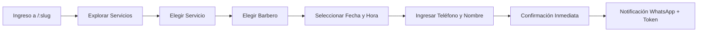
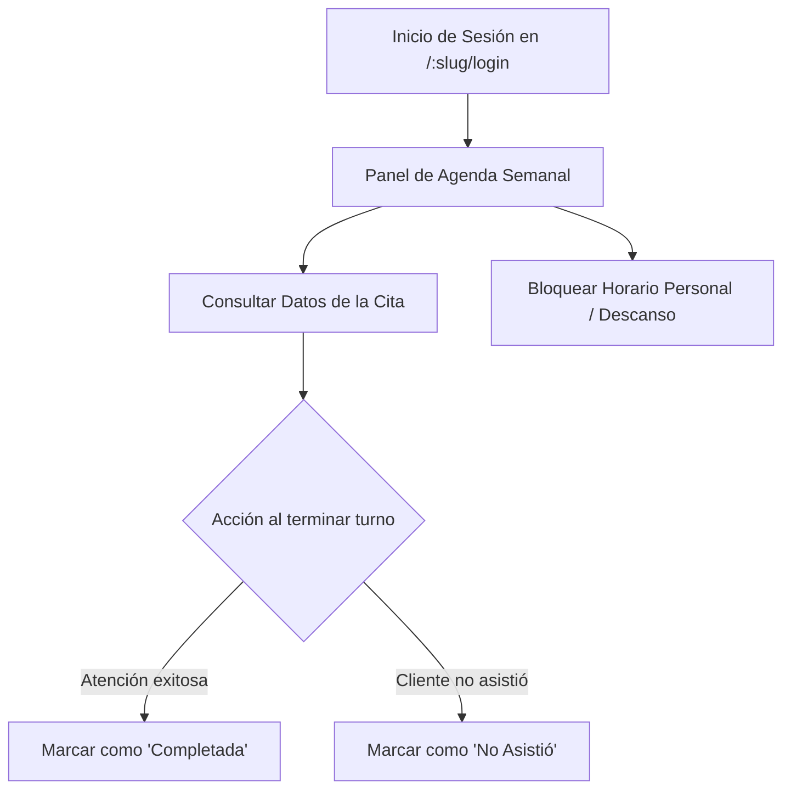
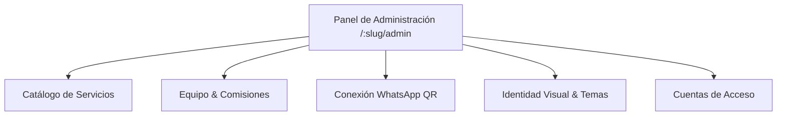
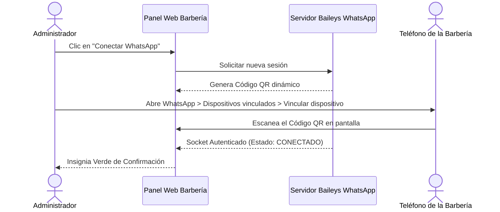

# 📖 Manual de Usuario del Sistema — Barbería VIP SaaS
### Plataforma Multi-Tenant de Gestión de Barberías y Agendamiento Online

> **Norma de Referencia:** IEEE Std 1063-2001 (R2007) / ISO/IEC/IEEE 26514:2018  
> **Versión del Documento:** 2.0.0 (Edición Multisede / Multi-Tenant)  
> **Fecha de Actualización:** Noviembre 2026  
> **Estado:** Documentación Oficial Operativa  

---

## 📑 Tabla de Contenidos

1. [Información General y Objetivos del Sistema](#1-información-general-y-objetivos-del-sistema)
2. [Requisitos de Acceso y Compatibilidad](#2-requisitos-de-acceso-y-compatibilidad)
3. [Módulo 1: Experiencia del Cliente e Invitado (Portal Público)](#3-módulo-1-experiencia-del-cliente-e-invitado-portal-público)
   * [3.1 Acceso al Portal de la Barbería](#31-acceso-al-portal-de-la-barbería)
   * [3.2 Exploración del Catálogo y Radar GPS](#32-exploración-del-catálogo-y-radar-gps)
   * [3.3 Flujo de Agendamiento Online en 4 Pasos](#33-flujo-de-agendamiento-online-en-4-pasos)
   * [3.4 Comprobante Digital y Confirmación por WhatsApp](#34-comprobante-digital-y-confirmación-por-whatsapp)
   * [3.5 Consulta y Cancelación de Cita con Token de Gestión](#35-consulta-y-cancelación-de-cita-con-token-de-gestión)
4. [Módulo 2: Operatoria del Barbero (Staff)](#4-módulo-2-operatoria-del-barbero-staff)
   * [4.1 Inicio de Sesión y Acceso Seguro](#41-inicio-de-sesión-y-acceso-seguro)
   * [4.2 Consulta de Agenda Diaria y Semanal](#42-consulta-de-agenda-diaria-y-semanal)
   * [4.3 Gestión de Estados de Cita (Completar / No-Show)](#43-gestión-de-estados-de-cita-completar--no-show)
   * [4.4 Bloqueo de Horarios Personales y Descansos](#44-bloqueo-de-horarios-personales-y-descansos)
5. [Módulo 3: Administración de la Barbería (Dueño / Manager)](#5-módulo-3-administración-de-la-barbería-dueño--manager)
   * [5.1 Configuración de la Identidad Visual y Temas](#51-configuración-de-la-identidad-visual-y-temas)
   * [5.2 Gestión del Catálogo de Servicios y Precios](#52-gestión-del-catálogo-de-servicios-y-precios)
   * [5.3 Gestión del Equipo de Barberos y Comisiones](#53-gestión-del-equipo-de-barberos-y-comisiones)
   * [5.4 Vinculación de WhatsApp Web mediante Código QR](#54-vinculación-de-whatsapp-web-mediante-código-qr)
   * [5.5 Configuración de Mensajes y Recordatorios Automáticos](#55-configuración-de-mensajes-y-recordatorios-automáticos)
6. [Módulo 4: Superadministración de la Plataforma](#6-módulo-4-superadministración-de-la-plataforma)
7. [Guía de Solución de Problemas y Preguntas Frecuentes (FAQ)](#7-guía-de-solución-de-problemas-y-preguntas-frecuentes-faq)

---

## 1. Información General y Objetivos del Sistema

**Barbería VIP SaaS** es una solución web integral diseñada para digitalizar, organizar y optimizar las operaciones de barberías modernas y cadenas de salones masculinos. 

El sistema resuelve dos necesidades fundamentales:
1. **Para los Clientes:** Permite reservar citas en menos de 1 minuto desde cualquier teléfono móvil o computadora, sin necesidad de descargar aplicaciones pesadas ni recordar contraseñas complejas.
2. **Para el Negocio:** Centraliza la agenda del equipo, previene solapamientos de turnos (doble reserva), calcula comisiones de barberos y automatiza el envío de recordatorios y confirmaciones vía WhatsApp.

### Estructura Multi-Tenant (Multisede)
El sistema opera bajo un esquema multi-inquilino. Cada barbería cuenta con un espacio independiente identificado por su identificador exclusivo denominado **Slug** (por ejemplo: `barberia-elite`, `the-king-cut`). Los datos, reservas, clientes y configuraciones de una barbería jamás se comparten ni son accesibles por otra barbería.

---

## 2. Requisitos de Acceso y Compatibilidad

### 2.1 Navegadores Compatibles
La plataforma está optimizada para funcionar en dispositivos móviles y de escritorio sin requerir plugins adicionales:
* **Google Chrome:** Versión 110 o superior (Recomendado).
* **Mozilla Firefox:** Versión 110 o superior.
* **Apple Safari (iOS / macOS):** Versión 15 o superior.
* **Microsoft Edge:** Versión 110 o superior.

### 2.2 Conexión y Dispositivos
* Conexión a Internet estable (mínimo 3G en móviles o banda ancha en computadoras).
* Habilitación de JavaScript y almacenamiento local (`localStorage`) en el navegador.

---

## 3. Módulo 1: Experiencia del Cliente e Invitado (Portal Público)

### 3.1 Acceso al Portal de la Barbería
El cliente ingresa directamente mediante el enlace web proporcionado por la barbería a través de redes sociales, afiches o códigos QR físicos:
$$\text{URL de Acceso: } \mathbf{https://barberia.app/:slug}$$

> *Ejemplo:* Si el negocio se llama "Barbería Elite", la dirección será `https://barberia.app/barberia-elite`.

---

### 3.2 Exploración del Catálogo y Radar GPS
Al entrar al portal, el cliente encuentra:
1. **Encabezado Comercial:** Logotipo, nombre comercial de la sede, horario de apertura general y lema del negocio.
2. **Radar GPS y Geolocalización:** Un mapa interactivo que indica la ubicación exacta de la sucursal y un botón directo para abrir la ruta en **Google Maps** o **Waze**.
3. **Enlaces a Redes Sociales:** Accesos directos al perfil de Instagram, página de Facebook, canal de WhatsApp y TikTok de la barbería.
4. **Catálogo de Servicios:** Tarjetas visuales de cada servicio disponible, mostrando fotografía, tiempo estimado en minutos y valor en moneda local.

---

### 3.3 Flujo de Agendamiento Online en 4 Pasos

Al presionar el botón **"Agendar Cita"** o seleccionar un servicio del catálogo, se inicia el asistente paso a paso (*Stepper*):

#### Paso 1: Selección del Servicio
* El cliente visualiza los servicios organizados por categorías (Cortes, Barba, Combos VIP, Cuidado Facial).
* Cada servicio muestra su precio y tiempo de duración.
* Al hacer clic en un servicio, se resalta y se activa el botón **"Continuar"**.

#### Paso 2: Selección del Barbero Profesional
* El sistema muestra los barberos de la sede habilitados para prestar el servicio seleccionado.
* Cada barbero cuenta con su foto de perfil y nombre.
* **Opción "Cualquier Profesional":** Si al cliente le es indiferente quién lo atienda, puede elegir esta opción para que el sistema le ofrezca el abanico más amplio de horas libres.

#### Paso 3: Selección de Fecha y Franja Horaria
* Se despliega un calendario interactivo que resalta los días en los que la sede o el barbero tienen turnos laborales.
* Al elegir una fecha, el sistema consulta en tiempo real los bloques disponibles de 30 o 45 minutos.
* **Protección Anti-Solapamiento:** Las horas ya ocupadas o bloqueadas por descanso no aparecerán disponibles.

#### Paso 4: Datos de Contacto y Confirmación
* El cliente ingresa únicamente la información esencial:
  * **Nombre Completo:** Para identificarlo al llegar a la sede.
  * **Teléfono Móvil (WhatsApp):** Canal por el cual recibirá el recordatorio y el enlace de su cita.
  * **Correo Electrónico (Opcional):** Si desea recibir copia de respaldo por email.
  * **Notas Adicionales (Opcional):** Comentarios especiales (ej: *"tengo piel sensible"*, *"iré con 10 minutos de antelación"*).
* Se presiona el botón **"Confirmar Reserva"**.

---

### 3.4 Comprobante Digital y Confirmación por WhatsApp
Una vez confirmada la cita:
1. **Pantalla de Éxito:** Se muestra en pantalla el comprobante digital con:
   * Código único de reserva.
   * Servicio, Barbero, Fecha y Hora agendada.
   * Dirección de la sede.
2. **Mensaje Automático de WhatsApp:** El cliente recibe en su teléfono un mensaje con el saludo oficial del negocio, los detalles de su cita y un **Enlace Directo de Auto-Gestión**.

---

### 3.5 Consulta y Cancelación de Cita con Token de Gestión
El cliente no necesita registrar una contraseña para administrar su cita. El mensaje de WhatsApp incluye un enlace con un **Token de Seguridad**:
$$\mathbf{https://barberia.app/:slug/reserva/:id?token=SECURE\_TOKEN}$$

* **Visualizar Estado:** El cliente puede comprobar si su cita está *Confirmada* o *En Proceso*.
* **Botón Cancelar Cita:** Si surge un imprevisto, el cliente puede cancelar su cita con un solo clic. El sistema liberará de inmediato la franja horaria para que otro cliente pueda tomarla y notificará al barbero.

> [!NOTE]
> Las cancelaciones suelen estar restringidas si faltan menos horas de las parametrizadas por la administración (por ejemplo, cancelaciones permitidas hasta 2 horas antes del turno).

---

## 4. Módulo 2: Operatoria del Barbero (Staff)

Este módulo está destinado a los profesionales que atienden a los clientes en los sillones de la barbería.

### 4.1 Inicio de Sesión y Acceso Seguro
1. El barbero ingresa a `https://barberia.app/:slug/login`.
2. Introduce sus credenciales (Correo y Contraseña) asignadas por el administrador, o inicia sesión mediante **Google OAuth2** si su correo fue previamente vinculado.
3. El sistema valida que el barbero pertenezca a la sede activa (`:slug`) y lo redirige a su panel de trabajo.

---

### 4.2 Consulta de Agenda Diaria y Semanal
El barbero dispone de un calendario interactivo donde visualiza:
* Sus citas programadas para el día de hoy ordenadas cronológicamente.
* Vista semanal para anticipar la carga de trabajo de los próximos días.
* Identificación por colores:
  * 🟡 **Pendiente / Confirmada:** Cita próxima por atender.
  * 🟢 **Completada:** Servicio finalizado con éxito.
  * 🔴 **Cancelada:** Liberada por el cliente o el administrador.
  * ⚪ **Bloqueo Personal:** Horario fuera de servicio.

---

### 4.3 Gestión de Estados de Cita (Completar / No-Show)
Al finalizar la atención en el sillón, el barbero actualiza el estado de la reserva:
* **Marcar como "Completada":** Cierra la cita en el sistema y suma el valor correspondiente al cálculo de comisiones del barbero.
* **Marcar como "No Asistió" (No-Show):** Registra que el cliente no se presentó a su cita, liberando el historial sin imputar comisiones erróneas.

---

### 4.4 Bloqueo de Horarios Personales y Descansos
Si un barbero necesita ausentarse durante su jornada laboral (almuerzo, trámite personal, descanso):
1. Hace clic en el botón **"Bloquear Horario"** de su agenda.
2. Selecciona la fecha, hora de inicio y hora de fin del bloqueo.
3. Ingresa un motivo breve (ej. *"Almuerzo"*).
4. El sistema bloquea de inmediato ese rango para que ningún cliente pueda agendar en ese intervalo.

---

## 5. Módulo 3: Administración de la Barbería (Dueño / Manager)

El Administrador tiene el control total sobre la configuración comercial, el personal, los precios y la comunicación del negocio.

---

### 5.1 Configuración de la Identidad Visual y Temas
El administrador puede personalizar la experiencia visual de su portal para reflejar la identidad corporativa de su barbería:
* **Carga de Logotipo y Banner:** Formatos PNG, JPG o WebP de alta resolución.
* **Paletas de Color (Theming Engine):** Selección entre 6 personalidades de color:
  * `clasico-azul` (Elegante y tradicional).
  * `cyber-lime` (Moderno y urbano).
  * `sunset-amber` (Cálido y vintage).
  * `midnight-cyan` (Tecnológico y nocturno).
  * `crimson-velvet` (Premium y exclusivo).
  * `monochrome-noir` (Minimalista en blanco y negro).
* **Modo Claro / Modo Oscuro:** Activación del modo oscuro por defecto o según la preferencia del dispositivo del cliente.
* **Redes Sociales y Dirección GPS:** Configuración de enlaces a redes sociales y coordenadas de Google Maps.

---

### 5.2 Gestión del Catálogo de Servicios y Precios
En la sección **"Servicios"**:
* **Crear Servicio:** Formulario con Nombre, Categoría, Precio de venta, Tiempo de duración (en múltiplos de 15 min) y Descripción de lo que incluye.
* **Fotografía del Servicio:** Subida de imagen ilustrativa del corte o tratamiento.
* **Activar / Desactivar Servicio:** Si un servicio deja de ofrecerse temporalmente, se puede pausar sin borrarlo ni alterar el historial contable anterior.

---

### 5.3 Gestión del Equipo de Barberos y Comisiones
En la sección **"Barberos / Personal"**:
1. **Crear Perfil de Barbero:** Ingreso de Nombre, Correo electrónico, Especialidad y Foto de perfil.
2. **Definir Horario Laboral Semanal:** Para cada día de la semana (Lunes a Domingo), se define:
   * Si labora o descansa.
   * Hora de inicio de jornada (ej. 09:00).
   * Hora de finalización (ej. 20:00).
   * Intervalo de descanso predeterminado.
3. **Esquema de Comisiones:** Asignación del porcentaje acordado con el profesional (ej. 45%, 50%). El sistema utiliza esta tasa para calcular los reportes de liquidación basados en citas marcadas como *Completadas*.

---

### 5.4 Vinculación de WhatsApp Web mediante Código QR
Para que el sistema envíe los mensajes de confirmación y recordatorios desde el número oficial de la barbería:

#### Procedimiento Paso a Paso:
1. En el panel de administración, diríjase a **Configuración > WhatsApp**.
2. Presione el botón **"Generar Código QR"**.
3. En el teléfono móvil que tiene la línea de WhatsApp de la barbería:
   * Abra WhatsApp.
   * Vaya a **Ajustes** (o tres puntos) > **Dispositivos vinculados**.
   * Presione **"Vincular un dispositivo"**.
4. Apunte la cámara del teléfono hacia la pantalla de su computadora y escanee el código QR.
5. Tras unos segundos, la pantalla mostrará una insignia verde: **"WhatsApp Conectado"**.

> [!IMPORTANT]
> El teléfono de la barbería debe mantener conexión a internet para que el servicio de mensajería continúe enviando confirmaciones en segundo plano.

---

### 5.5 Configuración de Mensajes y Recordatorios Automáticos
El administrador puede personalizar los textos que reciben los clientes:
* **Mensaje de Confirmación Inmediata:** Enviado al instante de agendar.
* **Recordatorio Anticipado:** Disparado automáticamente por el servidor con 2, 4 o 24 horas de antelación al turno.
* **Mensaje de Cancelación:** Enviado en caso de que la cita sea cancelada por el cliente o la administración.

**Variables dinámicas disponibles para las plantillas:**
* `{cliente_nombre}`: Nombre del cliente.
* `{servicio_nombre}`: Nombre del servicio reservado.
* `{barbero_nombre}`: Profesional asignado.
* `{fecha}` y `{hora}`: Momento pactado de la cita.
* `{enlace_gestion}`: URL para consultar o cancelar la cita.

---

## 6. Módulo 4: Superadministración de la Plataforma

Este nivel está reservado para los propietarios del software SaaS:
* **Alta de Nuevas Barberías (Tenants):** Registro de nuevos establecimientos y emisión de credenciales para el primer administrador.
* **Asignación y Validación de Slugs:** Comprobación de que el identificador (`barberia-x`) no colisione con nombres reservados (`admin`, `login`, `api`, `dashboard`).
* **Activación / Suspensión de Cuentas:** Capacidad de pausar sedes por motivos administrativos o vencimiento de membresía.

---

## 7. Guía de Solución de Problemas y Preguntas Frecuentes (FAQ)

### ❓ ¿Qué hacer si el bot de WhatsApp aparece desconectado?
* **Causa común:** El teléfono perdió señal de internet o se cerró la sesión desde el teléfono móvil.
* **Solución:**
  1. Ingrese a **Configuración > WhatsApp** en el panel de administración.
  2. Presione el botón **"Reconectar"** o **"Cerrar Sesión WhatsApp"**.
  3. Genere un nuevo Código QR y vuelva a escanearlo desde la aplicación móvil.

### ❓ Un cliente afirma que no encuentra horarios disponibles para hoy.
* **Causas posibles:**
  1. Todos los bloques del día ya fueron reservados por otros clientes.
  2. El barbero no tiene configurada esa jornada como día laborable en su horario semanal.
  3. El barbero registró un bloqueo de horario personal durante esas horas.
* **Solución:** Revise la agenda del barbero en el panel de horarios para verificar si quedan franjas libres o si se puede habilitar una extensión horaria.

### ❓ ¿Qué sucede si dos clientes intentan reservar exactamente la misma hora al mismo tiempo?
* El sistema cuenta con un índice de protección único en base de datos. Quien complete el formulario primero se adjudicará el turno; el segundo cliente recibirá una notificación amable indicándole: *"Este horario acaba de ser ocupado, por favor selecciona otro bloque disponible"*, garantizando **cero dobles reservas**.

### ❓ El cliente cerró la ventana de su navegador y no guardó el comprobante.
* No hay problema: los detalles completos de la cita, junto con el enlace de gestión directa, fueron enviados automáticamente a su WhatsApp.

### ❓ Mensaje de error: "No tienes permiso para acceder a esta barbería" al iniciar sesión.
* **Causa:** Intentó iniciar sesión con una cuenta perteneciente a otra sucursal o utilizó un enlace con un `:slug` diferente al asignado a su usuario.
* **Solución:** Verifique la URL en la barra de direcciones de su navegador para asegurarse de estar en la sede correspondiente a su cuenta.

---

> **Fin del Manual de Usuario**  
> *Para asistencia técnica avanzada o reportes de incidencias en la plataforma, consulte con el equipo de soporte técnico oficial.*

