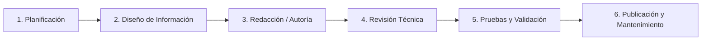

# 📘 Plan y Guía de Estilo de Documentación de Software
### Sistema Barbería VIP SaaS — Plataforma Multi-Tenant

> **Norma Internacional de Referencia:** ISO/IEC/IEEE 26514:2018  
> *(Systems and software engineering — Requirements for designers and developers of user documentation)*  
> **Estándares Articulados:** IEEE Std 1063-2001, Arc42 v8.2, OpenAPI v3.0, WCAG 2.1 Nivel AA  
> **Versión:** 2.0.0 (Edición Multisede)  
> **Fecha de Emisión:** Noviembre 2026  
> **Responsabilidad:** Dirección de Arquitectura & Calidad de Software  

---

## 📑 Tabla de Contenidos

1. [Objeto, Alcance y Marco Normativo](#1-objeto-alcance-y-marco-normativo)
2. [Matriz de Audiencias y Perfiles de Usuario (User Personas)](#2-matriz-de-audiencias-y-perfiles-de-usuario-user-personas)
3. [Ciclo de Vida de la Documentación (Cláusula 6 ISO 26514)](#3-ciclo-de-vida-de-la-documentación-cláusula-6-iso-26514)
4. [Guía de Estilo Editorial y Convenciones de Redacción](#4-guía-de-estilo-editorial-y-convenciones-de-redacción)
5. [Vocabulario Controlado y Taxonomía del Dominio](#5-vocabulario-controlado-y-taxonomía-del-dominio)
6. [Diseño Visual, Tipografía y Accesibilidad (WCAG AA)](#6-diseño-visual-tipografía-y-accesibilidad-wcag-aa)
7. [Matriz de Trazabilidad de Artefactos Documentales](#7-matriz-de-trazabilidad-de-artefactos-documentales)

---

## 1. Objeto, Alcance y Marco Normativo

El presente documento establece formalmente las directrices, convenciones, procesos y criterios de calidad para la creación, redacción, mantenimiento y publicación de toda la documentación técnica y de usuario del ecosistema **Barbería VIP SaaS** (Backend y Frontend), en estricto cumplimiento con la norma **ISO/IEC/IEEE 26514:2018**.

### Objetivos Específicos
* Garantizar que la documentación sea **completa, precisa, coherente, accesible y mantenible**.
* Proporcionar a cada perfil de lector (usuario final, staff, administrador o desarrollador) la información exacta en el formato idóneo y con el nivel de profundidad técnica adecuado.
* Articular de manera fluida los cuatro marcos documentales adoptados por la organización:
  1. **IEEE 1063:** Estructura de manuales de usuario y documentación de código.
  2. **ISO/IEC/IEEE 26514:** Gobierno, diseño editorial y ciclo de vida documental.
  3. **Arc42:** Memoria y comunicación de la arquitectura de software.
  4. **OpenAPI Specification (OAS 3.0):** Contratos interactivos de la API RESTful.

---

## 2. Matriz de Audiencias y Perfiles de Usuario (User Personas)

De acuerdo con la Cláusula 7 de la norma ISO 26514, los documentos deben diseñarse en función de las necesidades, habilidades y contexto de uso de sus destinatarios:

| Perfil de Audiencia | Descripción y Rol | Nivel Técnico | Artefacto Documental Asignado |
| :--- | :--- | :---: | :--- |
| **Cliente / Invitado** | Persona que busca un servicio y reserva una cita desde su teléfono móvil. | Nulo | `docs/MANUAL_DE_USUARIO.md` (Módulo 1) |
| **Barbero (Staff)** | Profesional que atiende en el sillón y consulta su agenda de turnos. | Básico | `docs/MANUAL_DE_USUARIO.md` (Módulo 2) |
| **Administrador de Sede** | Dueño o manager que gestiona precios, comisiones y vincula WhatsApp Web. | Intermedio | `docs/MANUAL_DE_USUARIO.md` (Módulo 3) |
| **Desarrollador / Integrador** | Ingeniero que implementa nuevas funciones o consume los endpoints de la API. | Avanzado | `docs/arc42/`, `docs/DOCS_PORTAL.md`, TypeDoc y `openapi.json` |
| **Administrador de Base de Datos** | Ingeniero encargado de persistencia, índices, integridad y migraciones. | Avanzado | `docs/DICCIONARIO_DE_DATOS.md` |
| **Auditor / Evaluador** | Revisor técnico que evalúa la calidad, seguridad OWASP y diseño del software. | Avanzado | `README.md` (raíz), `docs/arc42/` y Matriz de Requerimientos |

---

## 3. Ciclo de Vida de la Documentación (Cláusula 6 ISO 26514)

La documentación se gestiona como un activo de primer nivel (*Documentation-as-Code*) siguiendo las 6 etapas normativas:

1. **Planificación:** Al definir cualquier historia de usuario o requerimiento, se define qué manuales, endpoints o diagramas deben crearse o actualizarse.
2. **Diseño de Información:** Se selecciona la plantilla correspondiente (Arc42, IEEE 1063 o OpenAPI) definiendo la jerarquía y las tablas requeridas.
3. **Redacción / Autoría:** Redacción en Markdown estructurado o bloques JSDoc/TSDoc en el código fuente.
4. **Revisión Técnica (Peer Review):** Todo cambio en la documentación pasa por revisión de pull request para corroborar su exactitud respecto al código real.
5. **Pruebas y Validación:**
   * Validación tipográfica y de tipos con `npm run typecheck`.
   * Verificación de links internos y diagramas Mermaid.
   * Generación y validación del esquema OpenAPI (`npm run openapi:export`).
6. **Publicación y Mantenimiento:** Los archivos fuente en Markdown y JSON se versionan en Git; los artefactos compilados locales (`docs/html/`) se excluyen del repositorio para evitar desincronizaciones.

---

## 4. Guía de Estilo Editorial y Convenciones de Redacción

### 4.1 Tono y Voz
* **Manuales de Usuario:** Tono respetuoso, empático, claro y en segunda persona o tercera persona instructiva (*"Haga clic en...", "El cliente selecciona..."*). Sin abreviaturas técnicas crípticas.
* **Documentación Técnica / Arquitectura:** Tono formal, riguroso, objetivo y en tercera persona (*"El componente valida el token JWT...", "El middleware extrae el subdominio..."*).

### 4.2 Tipografía y Elementos de Interfaz
* **Elementos UI (Botones, Pestañas, Menús):** Siempre en **Negrita** (ej: presione el botón **"Confirmar Cita"**, diríjase a **Configuración > WhatsApp**).
* **Rutas, Comandos y Parámetros:** Siempre dentro de bloques de código en línea o con comillas invertidas (ej: `/:slug/reservar`, `npm run build`, `negocioId`).
* **Variables Dinámicas:** Con llaves y minúsculas (ej: `{cliente_nombre}`, `{fecha}`).

### 4.3 Sistema de Alertas Visuales (Callouts)
Para destacar información crítica sin romper el flujo de lectura:

> [!NOTE]
> Información contextual o detalles de funcionamiento interno que aportan valor adicional.

> [!TIP]
> Consejos de eficiencia operativa o mejores prácticas para el usuario o desarrollador.

> [!IMPORTANT]
> Requisitos indispensables o pasos obligatorios sin los cuales la acción no se completará.

> [!WARNING]
> Acciones destructivas o advertencias operativas (ej. liberación de turnos o desconexión de sesión).

### 4.4 Requisitos para Redactores de Documentación de Código (Code Documentation)
Conforme a los requisitos para redactores técnicos de la norma ISO/IEC/IEEE 26514:
* **Estandarización TSDoc / JSDoc:** Todo módulo, clase, método y función exportada debe documentarse con etiquetas formales:
  * `@param` para cada parámetro de entrada con su descripción funcional y restricciones.
  * `@returns` con la descripción del dato retornado, incluyendo estructuras compuestas o promesas.
  * `@throws` indicando de forma exhaustiva las excepciones esperadas (`NotFoundException`, `ConflictException`, `UnauthorizedException`).
  * `@remarks` para explicaciones arquitectónicas profundas (ej: comportamiento multitenant o aislamiento de base de datos).
  * `@example` para proporcionar snippets de código listos para su uso.
* **Declaración de Patrones de Diseño:** La documentación de código debe declarar explícitamente los patrones implementados (ej. *Facade Pattern* en servicios frontend, *Specification Pattern* en permisos de roles, *Guard / Decorator* en control de acceso).
* **Agrupación y Organización en Capas:** Las interfaces y clases deben catalogarse en TypeDoc según su capa arquitectónica (Controllers, Services, Repositories, DTOs, Guards).

### 4.5 Requisitos para Diseñadores de Documentación de Arquitectura (Architecture Documentation)
Para los diseñadores y arquitectos de software, la norma exige:
* **Estructura Canónica y Trazabilidad:** Uso mandatorio de la plantilla **Arc42** (12 capítulos) vinculando cada vista con los requerimientos funcionales y no funcionales del sistema.
* **Consistencia Visual en Diagramas:** Los modelos visuales deben seguir la notación declarativa estándar de **Mermaid**:
  * Diagramas de Contexto y Contenedores (Modelo C4).
  * Diagramas de Secuencia para flujos en tiempo de ejecución (autenticación Google OAuth2, reserva de citas, escaneo de QR WhatsApp).
  * Diagramas Entidad-Relación (`erDiagram`) con indicación precisa de claves primarias, foráneas y cardinalidad.
* **Registros de Decisiones de Arquitectura (ADRs):** Toda decisión estructural crítica (ej: uso de MariaDB, estrategia de aislamiento por tenant, Baileys para WhatsApp) debe documentarse con el formato estándar: *Contexto*, *Decisión*, *Consecuencias Positivas* y *Consecuencias Negativas*.
* **Evaluación de Atributos de Calidad:** Mapeo formal contra el estándar **ISO/IEC 25010** (Seguridad, Concurrencia, Disponibilidad, Mantenibilidad).

---

## 5. Vocabulario Controlado y Taxonomía del Dominio

Para evitar inconsistencias o ambigüedades en el equipo y en los usuarios, se define el siguiente vocabulario canónico:

| Término Oficial | Términos Prohibidos / Desaconsejados | Definición Operativa |
| :--- | :--- | :--- |
| **Sede / Negocio (Tenant)** | Local, Tienda, Empresa, Barbería-hija | Entidad comercial aislada con su propia base de datos lógica, servicios, barberos y tema. |
| **Slug** | Alias, Nick, URL-id | Identificador alfanumérico único en la URL que representa a la sede (ej: `barberia-elite`). |
| **Barbero** | Empleado, Peluquero, Operador | Profesional del staff asignado a un sillón que presta los servicios y genera comisiones. |
| **Reserva / Cita** | Turno, Ticket, Apartado | Compromiso de atención en una fecha y franja horaria determinada. |
| **Token de Gestión** | Contraseña de cita, PIN de cliente | Hash criptográfico único que permite al cliente consultar o cancelar su cita sin registrarse. |
| **No-Show** | Falta, Inasistencia, Plantón | Estado formal que indica que el cliente no se presentó a su cita en el horario pactado. |
| **Doble Reserva** | Conflicto de turno, Solapamiento | Incidencia prevenida por índice único donde dos clientes reservan el mismo minuto con el mismo barbero. |

---

## 6. Diseño Visual, Tipografía y Accesibilidad (WCAG AA)

Conforme a la Cláusula 8 de la norma ISO 26514:
* **Jerarquía de Encabezados:** Estricta secuencia lógica (H1 para título principal, H2 para secciones, H3 para subsecciones). Nunca omitir niveles.
* **Diagramas Mermaid:** Todos los flujos deben representarse visualmente con diagramas declarativos de fácil renderizado (`flowchart`, `sequenceDiagram`, `erDiagram`).
* **Fórmulas y Lógica Formal:** Expresadas mediante KaTeX/LaTeX estándar ($\mathbf{URL = https://host/:slug}$).
* **Hojas de Estilo TypeDoc (`typedoc-style.css`):**
  * Cumplen ratio de contraste mínimo 4.5:1 exigido por **WCAG 2.1 Nivel AA**.
  * Adaptabilidad completa a pantallas móviles (*Responsive Layout*).
  * Soporte equilibrado para paletas en Modo Claro y Modo Oscuro.

---

## 7. Matriz de Trazabilidad de Artefactos Documentales

| Estándar Internacional | Artefacto en el Repositorio | Audiencia Principal | Formato de Entrega |
| :--- | :--- | :--- | :---: |
| **ISO/IEC/IEEE 26514:2018** | `docs/PLAN_DE_DOCUMENTACION_ISO_26514.md` `docs/typedoc-style.css` | Equipo Técnico, Diseñadores y Auditores | Markdown / CSS |
| **IEEE Std 1063-2001** | `docs/MANUAL_DE_USUARIO.md` Comentarios JSDoc/TSDoc en código | Clientes, Barberos, Administradores y Devs | Markdown / Código fuente |
| **Arc42 v8.2** | `Barberia-Backend/docs/arc42/` (Capítulos 00 al 12) | Arquitectos de Software y Líderes Técnicos | Markdown estructurado |
| **OpenAPI Specification 3.0** | `docs/api/openapi.json` Swagger UI (`/api/docs`) | Desarrolladores Frontend e Integradores API | JSON / Swagger UI Web |
| **Modelo Relacional & ER** | `docs/DICCIONARIO_DE_DATOS.md` | Administradores de Base de Datos y Backend | Markdown + Mermaid ERD |

---

> **Aprobación y Vigencia:**  
> Este plan rige como estándar mandatorio de documentación técnica para todas las fases de desarrollo y auditoría del sistema Barbería VIP SaaS.

